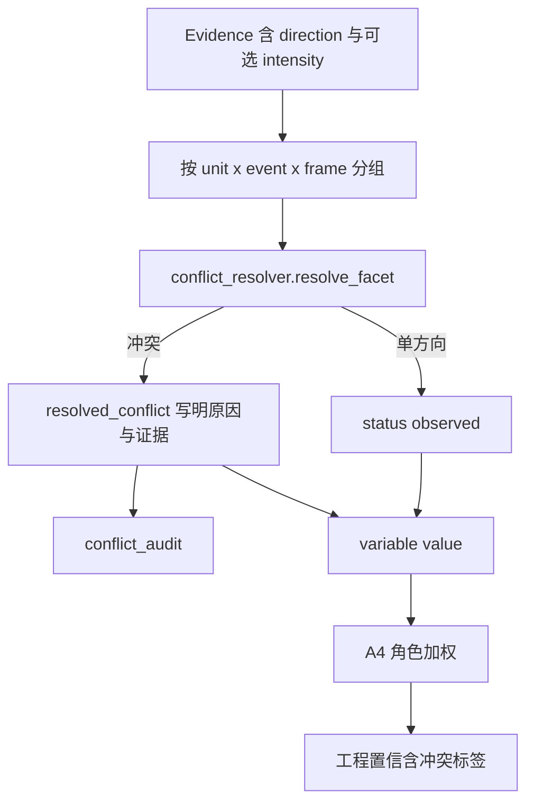
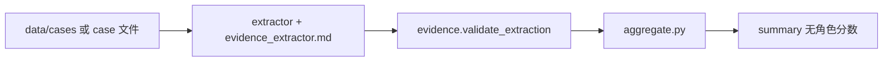

# 架构说明 0.6.1

## 1. 主路径数据流（多轮访谈）

```mermaid
flowchart LR
  A1[A1 scenario_agent] --> Ctrl[measurement_controller]
  Ctrl --> A2[A2 interviewer]
  A2 --> User[学生回答]
  User --> A3[A3 turn_extractor]
  A3 --> State[dialogue_state]
  State --> Profile[profile + conflict_resolver]
  Profile --> A4[risk_engine]
  A4 --> A5[risk_reporter]
  A5 --> Report[report.md]
```

| Agent | 代码 | 提示词 | 职责 |
| --- | --- | --- | --- |
| A1 | `scenario_agent.py` | `prompts/scenario_generator.md` | 按计划/蓝图实例化情境文本与 facts |
| A2 | `interviewer.py` | `prompts/interviewer.md` | 生成带目标单元的问题 |
| A3 | `turn_extractor.py` | `turn_extractor.md` + `turn_repair.md` | 抽取 observation / evidence / experiences；可选 intensity |
| 画像 | `profile.py` + `facets.py` + `conflict_resolver.py` + `experience.py` | — | Facet 汇总、冲突软消解、经历台账 |
| A4 | `risk_engine.py` | —（确定性加权，无 LLM） | 四角色 0–100 分数 |
| A5 | `risk_reporter.py` | `report_agent.md`（LLM）或模板 | 解释；不得改分数 |

编排：`dialogue_runner.py` + `dialogue_cli.py`；状态机：`measurement_controller.py`；契约：`dialogue_contracts.py`。

配置装载：`dialogue_config.py`（基于 `config_manifest.json` + 多轮配置）；底层量表：`config.py`（亦服务遗留路径）。

## 2. 冲突与强度（分析层）

- 框架优先级：真实经历 > 习惯 > 任务表现 > 一般信念 > 假设意向。
- 缺省强度见 `config/variable_scoring.json` 的 `frame_default_intensity`。
- 冲突：消解值满分权重计入风险分；原因/原话进报告第8节；不确定性进置信标签。

## 3. 遗留路径（单案例 round1）

- 规则：`config/evidence_rubric.json`（R_*），与多轮 `dialogue_rubric.json`（DR_*）分离。
- CLI：`validate` / `replay` / `extract` / `aggregate` / `prepare-prompt`（见 `cli.py`）。
- **不进入** 0.6.1 四角色主报告链路；仅工程兼容与旧单测。

## 4. 传输与 LLM

- `llm_client.py`：HTTP 调用与 doctor 诊断。
- `agent_transport.py`：JSON / LLM 传输抽象。
- 各 Agent 可在 `config/agents.example.json` 独立选择 backend。

## 5. Schema 边界

正式契约在 `schemas/`（如 `dialogue_state`、`profile`、`risk_result`）。空壳旧 schema 已删除。运行时 A3 观察 Schema 由 `dialogue_contracts.observation_schema()` 动态生成，亦可由 `scripts/export_dialogue_schemas.py` 导出。
